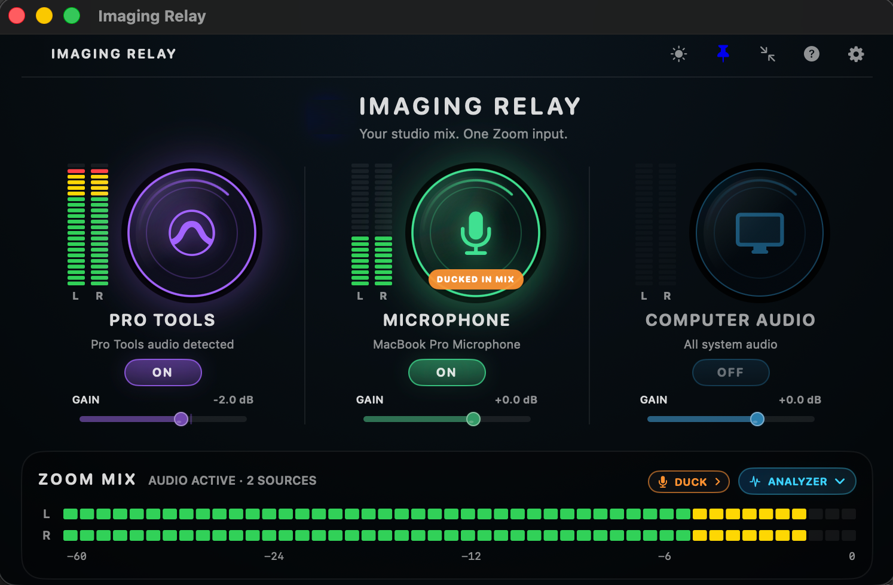
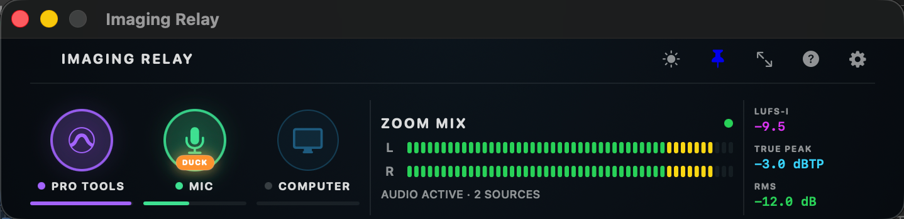
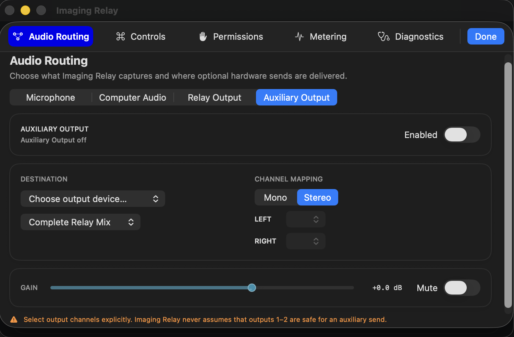
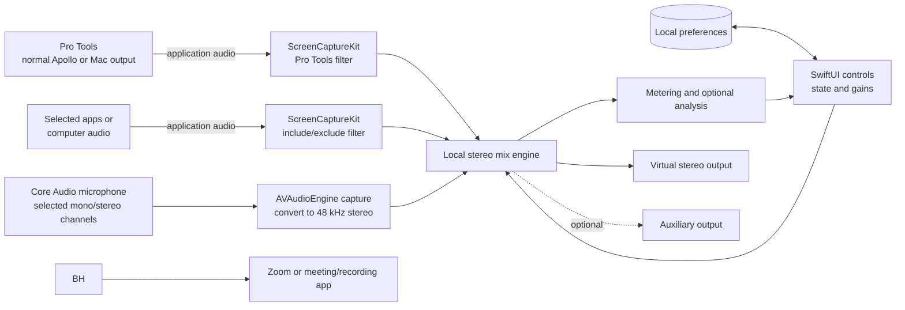

# Imaging Relay

A native macOS audio-routing prototype built to solve a specific workflow problem: **share Pro Tools, a live microphone, and selected computer audio through one simple stereo feed without changing the producer's normal monitoring setup**.

> **About this repository:** This is a public case study, not a source-code release. The application source remains private; the documentation focuses on the problem, product decisions, architecture, testing, and iteration.

---

## Why I built it

Audio producers often need to teach, review sessions, or collaborate remotely while sharing a Pro Tools session. Existing workflows can require virtual devices, aggregate devices, routing graphs, or changes to a producer's normal I/O and monitoring chain.

I wanted the workflow to answer a simpler question:

**How do we make it easy to share live Pro Tools audio during remote sessions without constantly rebuilding or disturbing the producer’s normal monitoring setup?**

Imaging Relay is organized around easy real-time DAW sharing:

- **Pro Tools**
- **Microphone**
- **Computer Audio**

Those sources feed one outgoing stereo mix that can be selected in Zoom or another recording/conferencing app.

---

## My contribution

I conceived Imaging Relay after running into the difficulty sharing live Pro Tools audio during remote sessions.

I defined the workflow, product requirements, interaction model, and audio behavior, then developed the prototype through an AI-assisted process. I tested each iteration in real Pro Tools, Apollo, and Zoom workflows and continued refining the product as routing, performance, permissions, and usability issues surfaced.

The Swift implementation was developed substantially with AI assistance. My role centered on defining what the product needed to do, directing the implementation, testing it in the production environment, and deciding what to change when an approach did not work.

---

## The product

### Core workflow

Imaging Relay captures and manages three sources:

1. **Pro Tools audio** using application-specific capture
2. **Microphone input** with selectable devices and channel mapping
3. **Computer audio** with application filtering to avoid duplication and feedback

Those sources are mixed locally into a stereo relay feed and sent to **virtual stereo audio device**, which can then be selected as the input for Zoom or another recording/conferencing app.

### Key capabilities

- capture Pro Tools without changing its normal playback engine
- combine Pro Tools, microphone, and selected computer audio into one mix
- reduce common feedback and double-capture problems
- support multichannel microphone input selection
- provide per-source gain control
- offer microphone **duck** or **mute** behavior driven by Pro Tools activity
- show live metering and optional analyzer tools
- provide a compact always-on-top mode
- support one optional **auxiliary output** for additional hardware routing

---

## Screenshots

### Main mixer

The main view makes live DAW/audio sharing controllable from one simple interface.

### Optional analyzer

An optional analyzer adds loudness, peak, spectrum, and stereo-field information without placing those controls in the default workflow. An illustration of this feature appears in the [personal-site project story](https://github.com/chrisclick/chrisclick-site/blob/main/projects/imaging-relay.html).

### Compact mode

Compact mode keeps source state and key level information visible while leaving more screen space for Pro Tools and the remote session.

### Routing / settings

More detailed device, channel, and auxiliary routing lives in Settings rather than on the main screen.

---

## Selected design decisions

### Validate the risky assumption first

Before building out the full product, I first tested whether Pro Tools could be captured as an application while continuing to use its normal monitoring path.

### Keep the main workflow narrow

The app is not intended to be a general-purpose patch bay. The main interface stays focused on three source categories, while device and routing details remain in Settings.

### Make OFF mean OFF

An early version kept capture engines active even when a source appeared off. I changed that behavior so an inactive source actually stops capture.

### Keep advanced analysis optional

The analyzer lives in a drawer rather than taking over the main interface. It is available when needed but not required for normal routing.

### Avoid unnecessary scope

The prototype does not include recording, waveform editing, mastering, or a general routing matrix. Those features were outside the collaboration problem I was trying to solve.

---

## Architecture summary

For more detail, see [docs/ARCHITECTURE.md](docs/ARCHITECTURE.md).

---

## Development highlights

- proved application-specific Pro Tools capture before building the full mixer
- added microphone capture and computer-audio capture with exclusions
- corrected a stale-buffer issue that initially caused severe delay
- added multichannel microphone selection after testing real interface configurations
- added microphone duck/mute automation to reduce speaker bleed and phasing
- added optional analyzer tools and later reduced unnecessary processing when they were hidden
- continued refining lifecycle recovery after sleep/wake behavior surfaced during testing

More detail: [docs/DEVELOPMENT_NOTES.md](docs/DEVELOPMENT_NOTES.md)

---

## Current status

Imaging Relay is a **working prototype / internal pilot**, not a production release.

The core workflow has been validated in hands-on use, but the project still has practical limitations:

- source code remains private
- the prototype relies on a separately installed virtual audio device
- signing/distribution was not completed as a production release
- testing has been primarily hands-on rather than automated
- sleep/wake recovery needs further work based on pilot feedback

---

## AI-assisted development

Imaging Relay was developed with substantial AI assistance.

I used ChatGPT and Codex to research unfamiliar macOS APIs and generate and revise much of the Swift implementation. I defined the requirements and product behavior, tested each build in the intended production workflow, and used the results to drive subsequent changes.

---

## Repository contents

- `README.md` — project overview
- `docs/ARCHITECTURE.md` — public technical architecture and audio flow
- `docs/DEVELOPMENT_NOTES.md` — major iterations, failures, and changes
- `docs/THIRD_PARTY_NOTICES.md` — dependency and attribution notes
