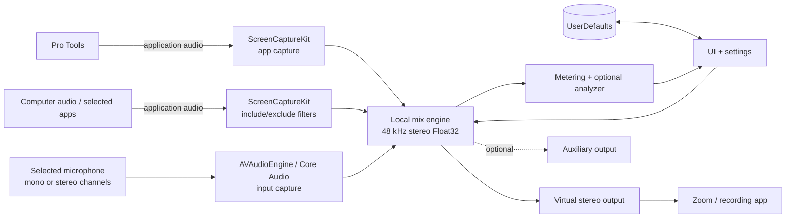

# Architecture

This document describes the public-facing technical architecture of Imaging Relay. It focuses on system behavior and design decisions rather than proprietary source code.

---

## Goal

Imaging Relay began with a specific problem: make it easier to share live Pro Tools audio during remote sessions without changing the producer's normal monitoring setup.

Our production workflow used Pro Tools with Apollo interfaces and UA Console. Audio could be routed into conferencing software, but doing so required additional routing and configuration around an otherwise working studio setup.

The prototype takes a different approach: capture Pro Tools independently of its physical output and send that audio to a virtual stereo output for use by Zoom or another recording/conferencing application.

As the project developed, microphone and selected computer-audio sources were added so the complete remote-session mix could be managed from the same interface.

---

## High-level architecture

---

## Main components

### Pro Tools capture

Application-specific audio capture isolates Pro Tools while the DAW continues playing through its normal physical output.

This was the central idea behind the project: make live Pro Tools audio available to a remote session without requiring the producer to change the DAW's normal Apollo or local monitoring path.

### Computer-audio capture

A second capture path was added for supporting computer audio or selected applications.

This made it possible to include sources such as browser playback or other production applications without changing the core Pro Tools-sharing workflow.

Filtering/exclusion logic helps avoid recapturing Pro Tools, Imaging Relay, or the conferencing application.

### Microphone capture

Microphone capture was added so the producer's voice could be included in the same outgoing session feed.

The microphone path supports:

- selectable input devices
- mono or stereo mapping
- non-default hardware channels

Testing with production interfaces showed that the microphone could not be assumed to live on input 1, so the routing was expanded to handle multichannel hardware.

### Local mix engine

The sources are combined into a stereo mix with:

- per-source gain
- final relay gain
- optional microphone duck/mute automation
- conservative output limiting

### Virtual output

The mixed signal is sent to a **virtual stereo audio device**, which makes the relay available as an input to Zoom or another recording/conferencing application.

The virtual audio device is a separate system dependency. Imaging Relay handles the capture, mixing, controls, metering, and routing workflow around it.

### Optional auxiliary output

One constrained auxiliary destination supports selected hardware-routing use cases without turning the app into a general-purpose routing matrix.

### Metering and analyzer

The interface provides two levels of signal feedback:

- operational source/output meters
- an optional analyzer with additional loudness, peak, spectrum, and stereo information

The analyzer is hidden when it is not needed.

---

## Audio path

The prototype uses a **48 kHz stereo Float32** internal mix.

The live path centers on:

- capture
- buffer management
- gain staging
- channel mapping
- microphone automation
- output routing
- metering and optional analysis

It does not load, edit, or render audio files.

---

## Interface structure

The main view stays focused on:

- source state
- source gain
- microphone automation state
- outgoing mix level

More technical controls live in Settings:

- microphone device/channel mapping
- selected application capture
- output routing
- permissions
- metering preferences
- diagnostics

---

## Privacy behavior

An early prototype kept source capture active even when the source was excluded from the outgoing mix.

That created a mismatch between the visual OFF state and the operating system's capture indicator. The behavior was changed so OFF stops the source capture engine.

A separate level-check workflow can be used when temporary preflight metering is needed.

---

## Performance and reliability

Several iterations focused on behavior that only became visible after the core routing worked:

- stale queued audio causing excessive delay
- analyzer processing overhead
- unnecessary UI publishing while hidden
- lifecycle recovery after display sleep/wake
- application/device changes while the app remained open

The sleep/wake path remains an area for further testing.

---

## Scope

This repository intentionally documents the architecture without publishing the private Swift implementation, build/signing details, device identifiers, diagnostics, or employer-specific deployment information.
